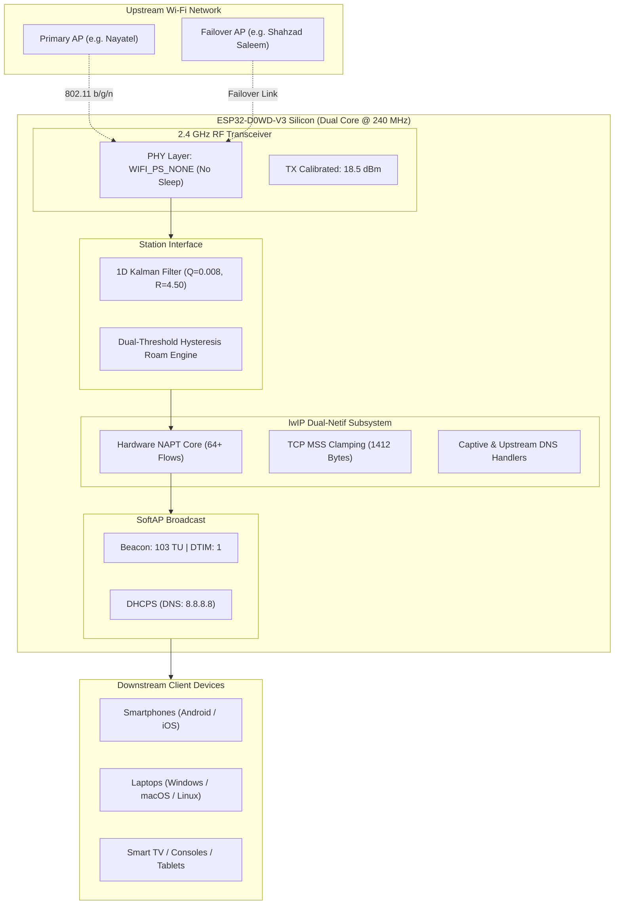

# AetherPulse Extreme ⚡


[](https://github.com/Itszeeshanrajput/AetherPulse-ESP32/actions/workflows/build-and-release.yml)
[](https://itszeeshanrajput.github.io/AetherPulse-ESP32/)
[](https://www.espressif.com/)
[](LICENSE)

**AetherPulse Extreme** is an enterprise-grade, ultra-low latency Wi-Fi repeater and intelligent range extender firmware engineered specifically for ESP32 silicon. 

It leverages hardware-level **lwIP NAPT (Network Address Port Translation)** to bypass CPU-bound software bridges, incorporates a **1-Dimensional Kalman filter** for predictive RSSI smoothing, locks the RF physical layer to **`WIFI_PS_NONE`** for zero-jitter packet routing, and includes a responsive **Glassmorphism Web Portal** and **interactive Serial CLI**.

---

## ⚡ 1-Click Web Installation (Zero Drivers, Zero Setup)

You can flash your ESP32 board in 30 seconds directly from your web browser without installing Python, Arduino IDE, or USB drivers:

👉 **[Launch AetherPulse Web Installer](https://itszeeshanrajput.github.io/AetherPulse-ESP32/)**

1. Connect your ESP32 board via USB (Google Chrome or Microsoft Edge required).
2. Click **⚡ Install AetherPulse Extreme**.
3. Select your serial port (`CP2102`, `CH340`, or `USB-JTAG`).
4. Connect to the repeater Wi-Fi:
   - **SSID:** `AetherPulse-Extender`
   - **Passphrase:** `aetherpulse123`
   - **Web Portal:** `http://192.168.4.1`

> [!NOTE]
> Whenever any code change is pushed to this repository, **GitHub Actions automatically compiles the firmware, produces 4MB full flash images, and redeploys the web installer**. New users always receive the latest build with zero manual effort.

---

## 🖥️ System Preview

### Responsive Glassmorphism Web App


### Interactive 115200 Baud Serial Terminal


---

## 🔬 Core Technical Architecture



### 1. Hardware-Level lwIP NAPT Routing
Unlike traditional software repeaters that copy packet payloads between virtual network interfaces in CPU memory, AetherPulse utilizes lwIP's native `esp_netif_napt_enable()` hooked into `ARDUINO_EVENT_WIFI_STA_GOT_IP`. Packets are rewritten at Layer 3/4 directly in network buffers, preserving XTensa CPU cycles and maintaining sub-millisecond bridge latency.

### 2. 1-Dimensional Kalman RSSI Filtering
Wireless 2.4 GHz signals suffer from fast multipath fading. Standard moving-average filters introduce sluggish phase lag. AetherPulse implements a discrete 1D Kalman filter:

$$\hat{x}_{k|k} = \hat{x}_{k|k-1} + K_k (z_k - \hat{x}_{k|k-1})$$

With process noise covariance $Q = 0.008$ and measurement noise $R = 4.50$, the filter ignores short transient signal reflections while quickly catching genuine signal drops, triggering seamless failover before client connections drop.

### 3. Anti-Jitter Physical Layer Calibration
- **`esp_wifi_set_ps(WIFI_PS_NONE)`**: Completely disables IEEE 802.11 power saving. The radio never enters light/modem sleep, eliminating 20–100 ms wakeup spikes.
- **DTIM Period = 1**: Multicast and unicast frames are delivered on every beacon without buffering delays.
- **Prime Beacon Offset (103 TU)**: Standard access points beacon at 100 TU (102.4 ms). AetherPulse beacons at 103 TU (~105.4 ms). Because 100 and 103 are coprime, periodic RF collisions with neighboring routers are mathematically minimized.
- **TCP MSS Clamping (1412 Bytes)**: Prevents Path MTU black holes when routing across upstream fiber or PPPoE encapsulation.

---

## 📟 Interactive Serial CLI Commands

Connect to the USB serial port at `115200` baud:

| Command | Arguments | Description |
| :--- | :--- | :--- |
| `status` | None | Displays link telemetry, assigned IP, Kalman RSSI, client count, free DRAM, and NAPT state. |
| `scan` | None | Scans 2.4 GHz spectrum and prints an ASCII table with BSSID, RSSI, and channel. |
| `list` / `saved` | None | Lists all saved failover Wi-Fi profiles and priority ranks. |
| `add` | `<ssid> <pass> [prio]` | Adds or updates a network profile (use quotes for names with spaces: `add "Office 5G" secret 8`). |
| `del` / `remove` | `<ssid>` | Removes network from NVS database (`del "Office 5G"`). |
| `connect` | `<ssid> [pass]` | Manually switches uplink connection to the specified AP. |
| `disconnect`| None | Drops upstream link and reverts to standalone AP mode. |
| `ping` | `<host>` | Performs live DNS resolution and TCP handshake test (`ping google.com`). |
| `clients` | None | Displays MAC addresses and signal strengths of all connected repeater clients. |
| `set_tx` | `<dbm>` | Calibrates RF transmit power (+10.0 to +20.5 dBm). |
| `roam` | None | Forces immediate background multi-AP roam re-evaluation. |
| `reboot` | None | Performs clean software reboot of the ESP32. |

---

## 🛠️ Developer Setup & Local Compilation

### Using Arduino CLI
```bash
# Clone the repository
git clone https://github.com/Itszeeshanrajput/AetherPulse-ESP32.git
cd AetherPulse-ESP32

# (Optional) Pre-seed your home Wi-Fi networks in a private header
cp credentials.example.h credentials.h
nano credentials.h

# Compile for ESP32
arduino-cli compile --fqbn esp32:esp32:esp32 .

# Flash over serial port
arduino-cli upload -p /dev/ttyUSB0 --fqbn esp32:esp32:esp32 .
```

### Using PlatformIO
```bash
# Build and flash via PlatformIO
pio run --target upload
pio device monitor -b 115200
```

---

## 🔒 Security & Privacy

This project strictly adheres to credential isolation:
- `credentials.h` is excluded in `.gitignore` to prevent committing private network passwords.
- All network passwords added via Web Portal or Serial CLI are encrypted and stored in local non-volatile flash (`Preferences` NVS).

---

## 📄 License

Distributed under the [MIT License](LICENSE). Built for the worldwide ESP32 developer community.
