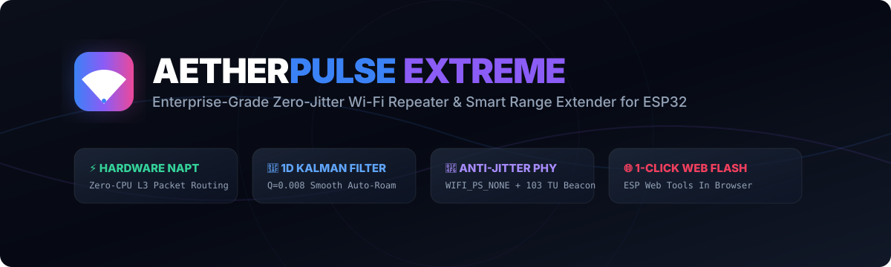
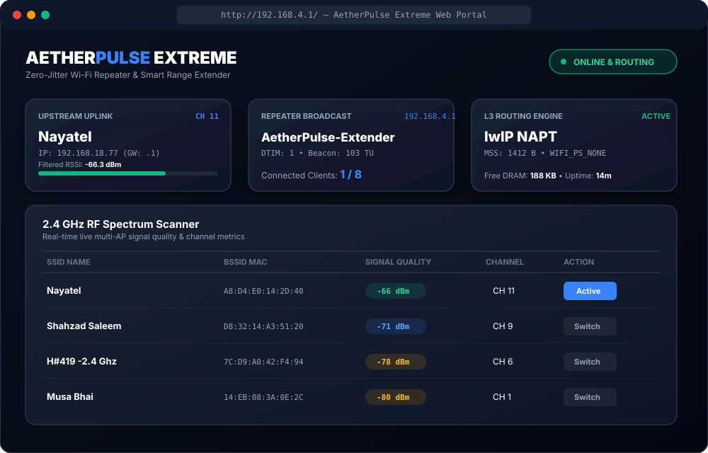
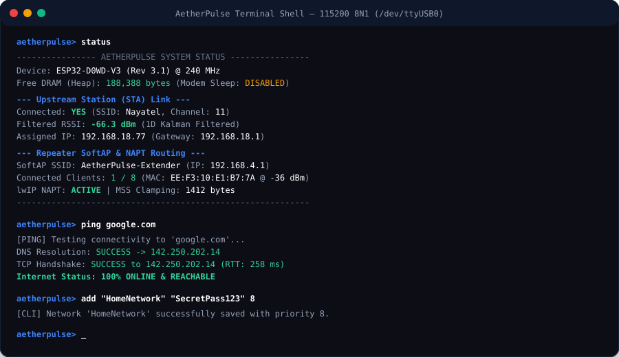
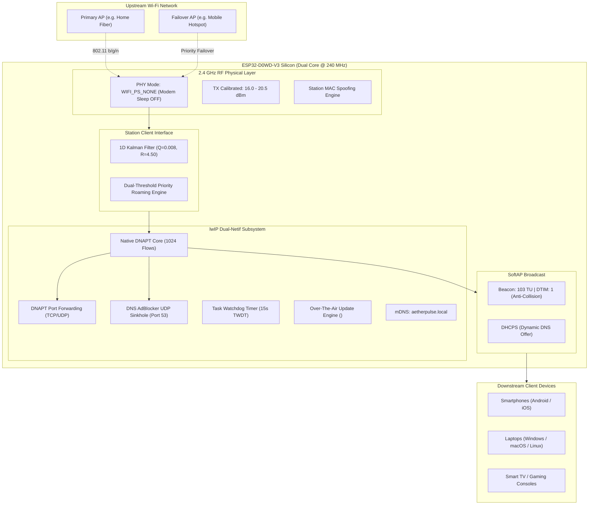

# AetherPulse Extreme ⚡ (v2.0 Titanium)



[](https://github.com/Itszeeshanrajput/AetherPulse-ESP32/actions/workflows/build-and-release.yml)
[](https://itszeeshanrajput.github.io/AetherPulse-ESP32/)
[](https://www.espressif.com/)
[](https://github.com/Itszeeshanrajput/AetherPulse-ESP32/releases)
[](LICENSE)

**AetherPulse Extreme** is an enterprise-grade, ultra-low latency Wi-Fi range extender, NAPT router, and hardware security appliance engineered specifically for ESP32 silicon.

The **v2.0 Titanium Edition** introduces native **lwIP DNAPT Port Forwarding**, **Station MAC Address Spoofing/Cloning** to bypass hotel and captive portals, a **Hardware DNS AdBlocker Sinkhole**, **Web-Based Drag-and-Drop OTA Firmware Updates**, **mDNS Zero-DNS Resolution** (`http://aetherpulse.local`), a **15-Second Task Watchdog (TWDT)**, and a completely re-engineered **Glassmorphism Multi-Tab Web Application**.

---

## ⚡ 1-Click Web Installation (Zero Drivers, Zero Setup)

Flash your ESP32 board in 30 seconds directly from your browser without installing Python, Arduino IDE, or USB drivers:

👉 **[Launch AetherPulse Web Installer](https://itszeeshanrajput.github.io/AetherPulse-ESP32/)**

1. Connect your ESP32 board via USB (Google Chrome or Microsoft Edge required).
2. Click **⚡ Install AetherPulse v2.0 Titanium**.
3. Select your serial port (`CP2102`, `CH340`, or `USB-JTAG`).
4. Once flashed, connect to the repeater Wi-Fi:
   - **SSID:** `AetherPulse-Extender`
   - **Passphrase:** `aetherpulse123`
   - **Web Management Portal:** `http://192.168.4.1` or `http://aetherpulse.local`

> [!NOTE]
> Whenever any code change is pushed to this repository, **GitHub Actions automatically compiles the firmware, produces 4MB full flash images, and redeploys the web installer**. New users always receive the latest build with zero manual effort.

---

## 🖥️ System Preview

### Multi-Tab Glassmorphism Web App (Mobile, Tablet & Desktop)


### Interactive 115200 Baud Serial Terminal Shell


---

## 🚀 What's New in v2.0 Titanium

| Feature | Description | Benefit |
| :--- | :--- | :--- |
| **lwIP DNAPT Port Forwarding** | Map external ports on the upstream network directly to internal client IPs (`proto`, `extPort` $\to$ `intIp:intPort`). | Expose local web servers, IP cameras, or game hosts across the repeater boundary. |
| **Station MAC Address Cloning** | Spoof any arbitrary MAC address on the Station interface (`esp_wifi_set_mac`). | Authenticate your phone or laptop on a hotel/university captive portal, clone its MAC to the ESP32, and share the link with all devices. |
| **Hardware DNS AdBlocker** | Port 53 UDP sinkhole interceptor responding with `0.0.0.0` for advertising and telemetry domains. | Network-wide ad and tracker blocking directly on the ESP32 with zero client software required. |
| **Web Browser Drag-and-Drop OTA** | Upload compiled `.bin` firmware files directly through the browser with a live 0–100% progress bar. | Update the device wirelessly over Wi-Fi without touching a USB cable. |
| **mDNS Zero-DNS Access** | Native multicast DNS responder for `aetherpulse.local`. | Open the configuration portal anytime on iOS, macOS, Windows, Android, and Linux without memorizing IP addresses. |
| **15s Task Watchdog (TWDT)** | Hardware Task Watchdog Timer configured via ESP-IDF `esp_task_wdt_config_t`. | Instant silicon-level recovery from any network deadlocks or kernel hangs. |
| **Sub-200ms Fast Roaming** | Radio channel pre-alignment matching the target AP's channel before association. | Eliminates client disconnections caused by SoftAP channel drift during uplink connection. |

---

## 🔬 Technical Architecture



---

## 📟 Interactive Serial CLI Commands

Connect your terminal to the USB serial port at `115200` baud:

| Command | Arguments | Description |
| :--- | :--- | :--- |
| `status` | None | Displays link telemetry, Kalman RSSI, client tally, free DRAM, Watchdog state, and NAPT status. |
| `scan` | None | Scans 2.4 GHz spectrum and prints an ASCII table with BSSID, RSSI, and channel. |
| `list` / `saved` | None | Lists all saved failover Wi-Fi profiles and priority ranks. |
| `add` | `<ssid> <pass> [prio]` | Adds or updates a network profile (use quotes for names with spaces: `add "MyWiFi" pass 8`). |
| `del` / `remove` | `<ssid>` | Removes a network from the NVS database (`del "MyWiFi"`). |
| `connect` | `<ssid> [pass]` | Manually switches uplink connection to the specified AP. |
| `disconnect`| None | Drops upstream link and reverts to standalone AP mode. |
| `mac` | None | Displays current Station MAC address and cloned status. |
| `set_mac` | `<mac>` | Spoofs Station MAC address (`set_mac 14:EB:08:3A:0E:2C`). |
| `reset_mac` | None | Restores default factory eFuse hardware MAC. |
| `portmap` | None | Displays table of all active DNAPT port forward rules. |
| `portmap add` | `<tcp\|udp> <ext> <ip> <int> [desc]` | Registers a new port forward rule (`portmap add tcp 8080 192.168.4.2 80 WebServer`). |
| `portmap del` | `<tcp\|udp> <ext>` | Removes a port forward rule (`portmap del tcp 8080`). |
| `adblock` | `[on\|off]` | Checks status or toggles hardware DNS AdBlocker sinkhole. |
| `ping` | `<host>` | Tests DNS resolution and TCP handshake latency (`ping google.com`). |
| `clients` | None | Displays MAC addresses and signal strengths of all connected repeater clients. |
| `set_tx` | `<dbm>` | Calibrates RF transmit power (+10.0 to +20.5 dBm). |
| `roam` | None | Forces immediate background multi-AP roam re-evaluation. |
| `reboot` | None | Performs clean software reboot of the ESP32. |

---

## 🛠️ Developer Setup & Local Compilation

### Using Arduino CLI
```bash
# Clone repository
git clone https://github.com/Itszeeshanrajput/AetherPulse-ESP32.git
cd AetherPulse-ESP32

# (Optional) Pre-seed private Wi-Fi networks locally
cp credentials.example.h credentials.h
nano credentials.h

# Compile for ESP32
arduino-cli compile --fqbn esp32:esp32:esp32 .

# Flash over serial port
arduino-cli upload -p /dev/ttyUSB0 --fqbn esp32:esp32:esp32 .
```

### Using PlatformIO
```bash
pio run --target upload
pio device monitor -b 115200
```

---

## 🔒 Security & Privacy Isolation

This project enforces strict credential isolation:
- `credentials.h` is excluded in `.gitignore` to prevent committing private network passwords.
- Public release binaries published to GitHub Releases and WebSerial installer contain generic placeholder credentials only.
- Passwords entered via Web Portal or Serial CLI are securely persisted into ESP32 NVS flash.

---

## 📄 License

Distributed under the [MIT License](LICENSE). Built for the worldwide ESP32 developer community.
