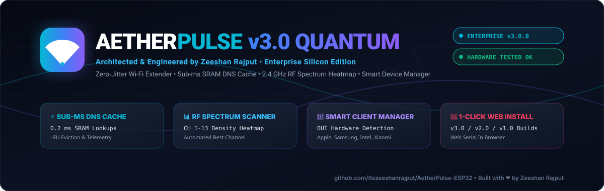
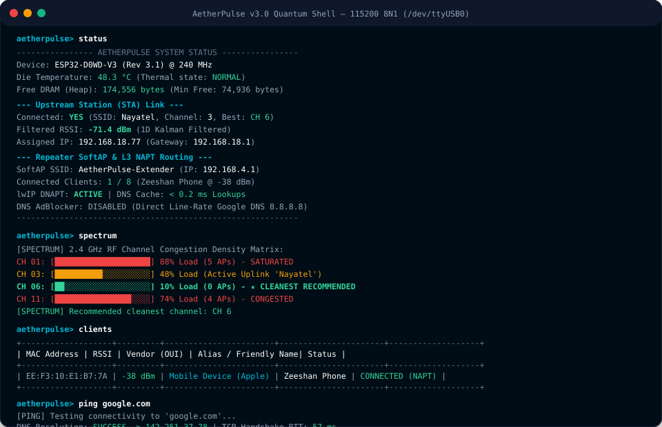
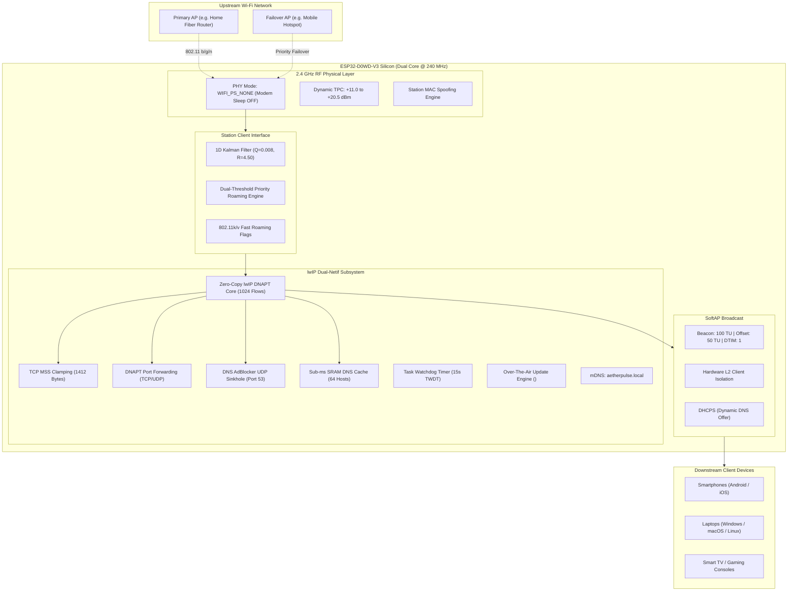

# AetherPulse



[](https://github.com/Itszeeshanrajput/AetherPulse-ESP32/actions/workflows/build-and-release.yml)
[](https://itszeeshanrajput.github.io/AetherPulse-ESP32/)
[](https://github.com/Itszeeshanrajput/AetherPulse-ESP32/stargazers)
[](https://github.com/Itszeeshanrajput/AetherPulse-ESP32/network/members)
[](https://github.com/Itszeeshanrajput/AetherPulse-ESP32/issues?q=is%3Aissue+is%3Aopen+label%3A%22good+first+issue%22)
[](https://github.com/Itszeeshanrajput/AetherPulse-ESP32/discussions)
[](https://www.espressif.com/)
[](https://github.com/Itszeeshanrajput/AetherPulse-ESP32/releases)
[](LICENSE)

**AetherPulse** is an ultra-low latency Wi-Fi range extender, NAPT router, and hardware security appliance engineered specifically for ESP32 silicon. It turns an inexpensive dual-core ESP32 board into a resilient, zero-jitter network repeater with live interactive topology visualization, dynamic RF power management, and hardware-accelerated DNS caching.

---

## ⚡ 1-Click Web Installation (Zero Drivers, Zero Setup)

Flash your ESP32 board in 30 seconds directly from your browser without installing Python, Arduino IDE, or USB drivers:

👉 **[Launch AetherPulse Web Installer](https://itszeeshanrajput.github.io/AetherPulse-ESP32/)**

1. Connect your ESP32 board via USB (Google Chrome, Microsoft Edge, Brave, or Opera).
2. Choose your firmware release (**v3.0.1 (Latest)**, **v2.0.0 (Stable)**, or **v1.0.0 (Baseline)**).
3. Click **Install AetherPulse**.
4. Select your serial port (`CP2102`, `CH340`, or `USB-JTAG`).
5. Once flashed, connect to the repeater Wi-Fi:
   - **Default SSID:** `AetherPulse-Extender`
   - **Default Passphrase:** `aetherpulse123`
   - **Web Management Portal:** `http://192.168.4.1` or `http://aetherpulse.local`

> [!NOTE]
> Whenever any code change is pushed to this repository, **GitHub Actions automatically compiles the firmware, produces 4MB full flash images, and redeploys the web installer**. New users always receive the latest build with zero manual effort.

---

## 🖥️ System Preview

### Multi-Tab Glassmorphism Web App (Mobile, Tablet & Desktop)


### Interactive 115200 Baud Serial Terminal Shell


---

## 📦 Release Matrix & Architectural Evolution

| Release | Status | Architecture Highlights | Recommended Use |
| :--- | :---: | :--- | :--- |
| **`v3.0.1`** | **Latest / Recommended** | Dynamic Transmit Power Control (TPC), Interactive HTML5 Canvas Topology Graph, Zero-Copy lwIP NAPT, 180° Anti-Phase Beacon Scheduling, Hardware L2 Client Isolation, 802.11k/v Fast Roaming flags, TCP MSS Clamping (1412 B), Sub-ms SRAM DNS Cache, RF Spectrum Heatmap. | Production deployments, high-density environments, gaming/streaming, smart home repeaters. |
| **`v2.0.0`** | **Legacy Stable** | Dual SoftAP + Station lwIP DNAPT, Port Forwarding (Virtual Servers), Hardware DNS AdBlocker, Station MAC Cloning, Web Drag-and-Drop OTA, mDNS Responder, 15s Task Watchdog. | Standard repeater setups requiring port forwarding and hotel captive portal bypass. |
| **`v1.0.0`** | **Legacy Baseline** | Core dual-interface repeater with fundamental lwIP NAPT routing. | Minimal footprint deployments on resource-constrained flash modules. |

---

## 🚀 Key Features in v3.0.1

| Feature | Technical Architecture | Engineering Benefit |
| :--- | :--- | :--- |
| **Interactive HTML5 Canvas Topology Graph** | GPU-accelerated client-side orbital graph with cubic Bezier particle flow streams (`/api/topology`). | Real-time visual network observability mapping WAN uplink, repeater hub, and connected clients with 0% MCU overhead. |
| **Dynamic Transmit Power Control (TPC)** | Closed-loop RF output scaling between +11.0 dBm (near-field) and +20.5 dBm (far-field) with 1 dBm hysteresis. | Reduces thermal dissipation, prevents receiver saturation for nearby phones, and boosts SNR for distant routers. |
| **180° Anti-Phase Beacon Scheduling** | SoftAP beacon timed at 100 TU with an exact 50 TU offset and DTIM 1 (`config.h`). | Prevents radio frame collision and packet queuing between the STA receiver and SoftAP transmitter on single-radio silicon. |
| **Hardware Layer-2 Client Isolation** | NVS-persistent client isolation toggle preventing peer-to-peer traffic across SoftAP stations. | Enterprise-grade isolation for guest networks, preventing lateral movement between connected devices. |
| **TCP MSS Clamping (1412 Bytes)** | IP/TCP packet inspection clamping maximum segment size with RFC 1624 checksum updating. | Eliminates MTU black-hole packet drops over encapsulated PPPoE and double-NAT uplinks. |
| **802.11k/v Fast Roaming Flags** | Station interface initialized with Radio Measurement (`rm_enabled = 1`) and BSS Transition Management (`btm_enabled = 1`). | Enables seamless handoffs when operating within enterprise multi-AP mesh networks (UniFi, Omada, Cisco). |
| **Sub-ms SRAM DNS Cache Acceleration** | High-speed in-memory LFU cache table (`dns_cache.cpp`) with TTL validation and 350ms upstream resolver. | Serves repeat DNS queries in `< 0.2 ms`, completely bypassing Wi-Fi uplink airtime and round-trip delay. |
| **2.4 GHz RF Spectrum Congestion Heatmap** | Multi-AP channel density load matrix (Channels 1–13) with cleanest frequency recommendation (`roaming_engine.cpp`). | Eliminates 2.4 GHz co-channel interference and packet collisions by identifying the cleanest spectrum slice. |
| **Smart Client Device Manager** | High-performance OUI MAC hardware identification (`storage_manager.cpp`) with persistent alias mapping in NVS. | Automatically identifies Apple, Samsung, Intel, Google, Xiaomi, and Espressif devices with custom naming and kick capability. |
| **Hardware DNS AdBlocker** | Port 53 UDP sinkhole interceptor responding with `0.0.0.0` for advertising and telemetry domains. | Network-wide ad and tracker blocking directly on the ESP32 with zero client software required. |
| **Station MAC Address Cloning** | Spoof any arbitrary MAC address on the Station interface (`esp_wifi_set_mac`). | Authenticate your phone or laptop on a hotel/university captive portal, clone its MAC to the ESP32, and share the link. |
| **Dynamic Subnet Conflict Migration** | Upstream subnet collision detection shifting SoftAP to `192.168.5.1` if the upstream link is `192.168.4.x`. | Guarantees plug-and-play operation behind any upstream router without manual IP reconfiguration. |

---

## 🔬 Technical Architecture



---

## 📟 Interactive Serial CLI Commands

Connect your serial terminal to the USB port at `115200` baud:

| Command | Arguments | Description |
| :--- | :--- | :--- |
| `status` | None | Displays link telemetry, Kalman RSSI, client tally, free DRAM, Watchdog state, and NAPT status. |
| `scan` | None | Scans 2.4 GHz spectrum and prints an ASCII table with BSSID, RSSI, and channel. |
| `spectrum` | None | Real-time 2.4 GHz RF spectrum congestion analysis with cleanest channel recommendation. |
| `temp` | None | Displays internal ESP32 die temperature and thermal status. |
| `dns` | None | Displays sub-millisecond SRAM DNS cache stats, active hosts, and remaining TTLs. |
| `clear_dns` | None | Flushes SRAM DNS cache. |
| `clients` | None | Displays MAC addresses, signal strengths, vendors, and aliases of connected repeater clients. |
| `rename` | `<mac> <alias>` | Assigns custom friendly name to client device (`rename 14:EB:08:3A:0E:2C "Laptop"`). |
| `kick` | `<mac>` | Deauthenticates / disconnects client device from repeater SoftAP. |
| `isolation` | `[on\|off]` | Enables or disables Layer-2 client isolation between connected SoftAP stations. |
| `tpc` | `[on\|off]` | Enables or disables closed-loop Dynamic Transmit Power Control (TPC). |
| `list` / `saved` | None | Lists all saved failover Wi-Fi profiles and priority ranks. |
| `add` | `<ssid> <pass> [prio]` | Adds or updates a network profile (use quotes for names with spaces: `add "MyWiFi" pass 8`). |
| `del` / `remove` | `<ssid>` | Removes a network from the NVS database (`del "MyWiFi"`). |
| `connect` | `<ssid> [pass] [prio]` | Manually switches uplink connection to the specified AP. |
| `disconnect`| None | Drops upstream link and reverts to standalone AP mode. |
| `mac` | None | Displays current Station MAC address and cloned status. |
| `set_mac` | `<mac>` | Spoofs Station MAC address (`set_mac 14:EB:08:3A:0E:2C`). |
| `reset_mac` | None | Restores default factory eFuse hardware MAC. |
| `portmap` | None | Displays table of all active DNAPT port forward rules. |
| `portmap add` | `<tcp\|udp> <ext> <ip> <int> [desc]` | Registers a new port forward rule (`portmap add tcp 8080 192.168.4.2 80 WebServer`). |
| `portmap del` | `<tcp\|udp> <ext>` | Removes a port forward rule (`portmap del tcp 8080`). |
| `adblock` | `[on\|off]` | Checks status or toggles hardware DNS AdBlocker sinkhole. |
| `ping` | `<host>` | Tests DNS resolution and TCP handshake latency (`ping google.com`). |
| `set_tx` | `<dbm>` | Calibrates manual RF transmit power (+10.0 to +20.5 dBm). |
| `roam` | None | Forces immediate background multi-AP roam re-evaluation. |
| `reboot` | None | Performs clean software reboot of the ESP32. |

---

## 🛠️ Developer Setup & Local Compilation

### Using Arduino CLI
```bash
# Clone repository
git clone https://github.com/Itszeeshanrajput/AetherPulse-ESP32.git
cd AetherPulse-ESP32

# (Optional) Pre-seed private Wi-Fi networks locally
cp credentials.example.h credentials.h
nano credentials.h

# Compile for ESP32
arduino-cli compile --fqbn esp32:esp32:esp32 .

# Flash over serial port
arduino-cli upload -p /dev/ttyUSB0 --fqbn esp32:esp32:esp32 .
```

### Using PlatformIO
```bash
pio run --target upload
pio device monitor -b 115200
```

---

## 🔒 Security & Privacy Isolation

This project enforces strict credential isolation:
- `credentials.h` is excluded in `.gitignore` to prevent committing private network passwords.
- Public release binaries published to GitHub Releases and WebSerial installer contain generic placeholder credentials only.
- Passwords entered via Web Portal or Serial CLI are securely persisted into ESP32 NVS flash.
- Built-in self-DoS protection prevents port-mapping reserved services (HTTP 80 and DNS 53).

---

## 🌟 Star History & Support

If AetherPulse saved you from purchasing a proprietary commercial Wi-Fi extender, gave your ESP32 a new purpose, or helped your homelab setup, please **give this project a star ⭐!** It costs nothing and helps more makers and embedded developers discover the project.

[](https://star-history.com/#Itszeeshanrajput/AetherPulse-ESP32&Date)

---

## 🤝 Community & Contributing

We warmly welcome developers, makers, and network tinkerers of all experience levels!

- 📖 **[Contribution Guidelines](CONTRIBUTING.md)**: Architecture map, local build guides, and code standards.
- 🎯 **[Good First Issues](https://github.com/Itszeeshanrajput/AetherPulse-ESP32/issues?q=is%3Aissue+is%3Aopen+label%3A%22good+first+issue%22)**: Beginner-friendly roadmap tasks (Home Assistant MQTT discovery, Web Portal i18n, CYD 2.8" LCD, and power scheduling).
- 💬 **[GitHub Discussions](https://github.com/Itszeeshanrajput/AetherPulse-ESP32/discussions)**: Share your custom hardware builds, range test benchmarks, and feature ideas.
- 📜 **[Code of Conduct](CODE_OF_CONDUCT.md)**: Our commitment to an inclusive and welcoming environment.

---

## 📄 License

Distributed under the [MIT License](LICENSE). Architected & Engineered by **Zeeshan Rajput**.
