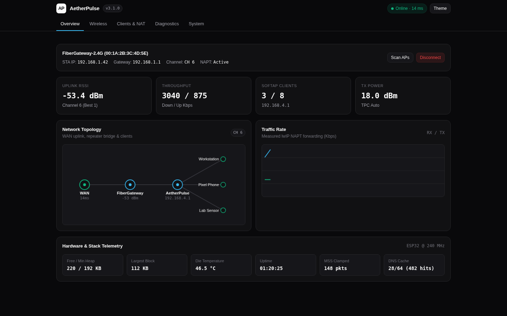
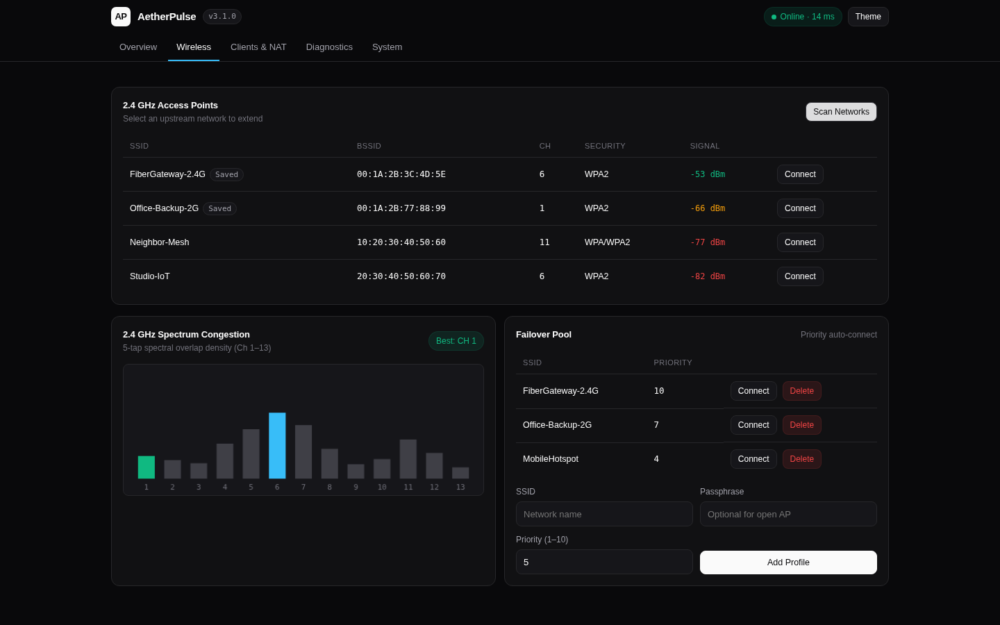
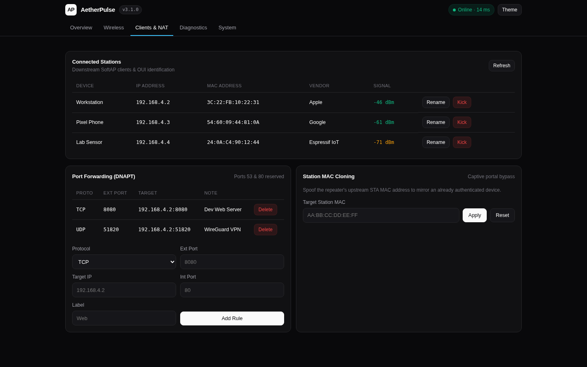
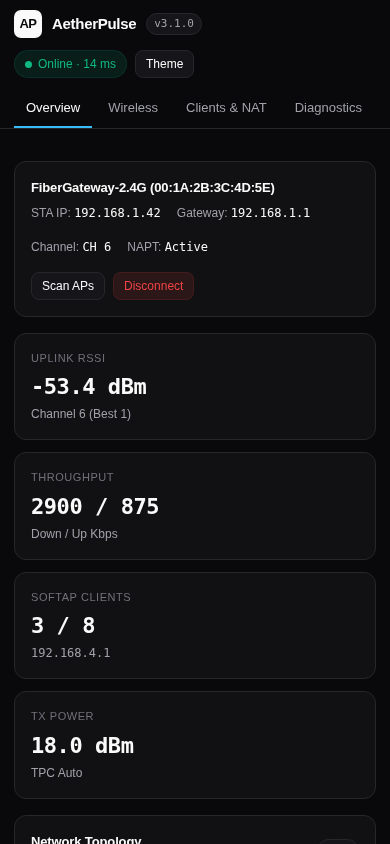
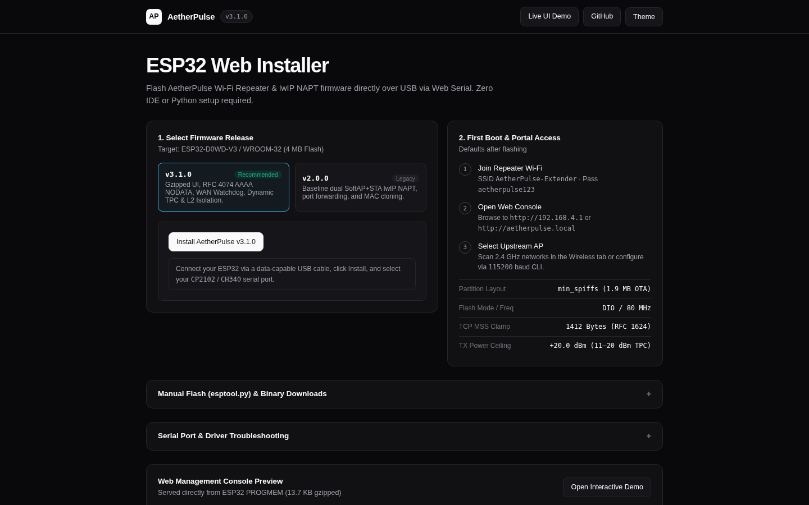
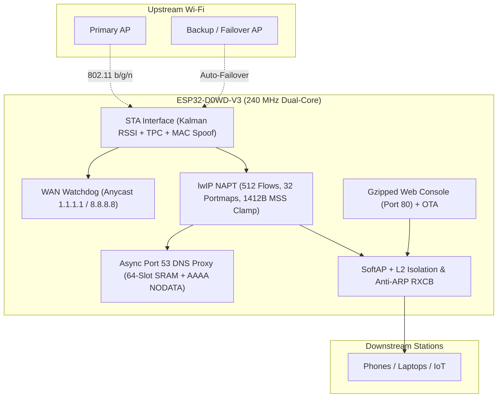

# AetherPulse


[](https://github.com/Itszeeshanrajput/AetherPulse-ESP32/actions/workflows/build-and-release.yml)
[](https://itszeeshanrajput.github.io/AetherPulse-ESP32/)
[](https://itszeeshanrajput.github.io/AetherPulse-ESP32/demo.html)
[](https://github.com/Itszeeshanrajput/AetherPulse-ESP32/releases)
[](LICENSE)

**AetherPulse** is a compact, low-latency Wi-Fi range extender and lwIP IPv4 NAPT router for the **ESP32** (`ESP32-D0WD-V3` / `WROOM-32`). It combines dual SoftAP+Station forwarding, RFC 1624 TCP MSS clamping, autonomous Anycast WAN failover, an SRAM DNS proxy with RFC 4074 `AAAA` NODATA synthesis, and a gzip-compressed 13.7 KB Web Management Console.

> [!NOTE]
> **Public Beta Testing (`v3.1.0-beta.1`):** This release is marked for beta testing. Please open an issue via the [Bug Report template](.github/ISSUE_TEMPLATE/bug_report.md) with `status`, `netdebug`, and `crashlog` CLI output if you encounter any edge cases.

---

## 1-Click Web Installation

Flash directly from Desktop Chrome, Edge, Brave, or Opera over USB (`Web Serial`)—no IDE or Python setup required:

- **Web Installer:** [itszeeshanrajput.github.io/AetherPulse-ESP32](https://itszeeshanrajput.github.io/AetherPulse-ESP32/)
- **Interactive UI Demo:** [itszeeshanrajput.github.io/AetherPulse-ESP32/demo.html](https://itszeeshanrajput.github.io/AetherPulse-ESP32/demo.html)

1. Connect your ESP32 board over USB and open the Web Installer.
2. Select **v3.1.0-beta.1 (Beta)** and click **Install AetherPulse v3.1.0-beta.1**.
3. Choose your serial port (`CP2102`, `CH340`, or `USB-JTAG`).
4. Connect to the repeater Wi-Fi after reboot:
   - **SSID:** `AetherPulse-Extender`
   - **Passphrase:** `aetherpulse123`
   - **Web Console:** `http://192.168.4.1` or `http://aetherpulse.local`

---

## Real Web UI & Web Flasher Screenshots

### Overview, Network Topology & Measured Traffic


### Wireless Scanner, 2.4 GHz Spectrum & Failover Pool


### Connected Stations, Port Forwarding & MAC Cloning


| Mobile Responsive Console (`390×844`) | Minimalist Web Serial Flasher |
| :---: | :---: |
|  |  |

---

## Release Matrix

| Release | Status | Highlights |
| :--- | :---: | :--- |
| **`v3.1.0-beta.1`** | **Beta Testing** | 13.7 KB gzipped Web Console (Dark/Light), measured NAPT RX/TX telemetry, `AP_START`/SoftAP NAPT persistence fix, RFC 4074 `AAAA` NODATA DNS cache, quantized Dynamic TPC (`11.0–20.0 dBm`), alignment-aware RFC 1624 MSS clamping (`1412 B`), L2 station isolation + anti-ARP spoofing, CRC-32 NVS shadow journal, hardened OTA. |
| **`v2.0.0`** | **Legacy** | Dual SoftAP+STA lwIP NAPT, DNAPT port forwarding, Station MAC cloning, mDNS responder, 15s TWDT. |

---

## Key Engineering Features (`v3.1.0-beta.1`)

| Subsystem | Implementation | Benefit |
| :--- | :--- | :--- |
| **lwIP IPv4 NAPT & Hairpin** | Native `WiFi.AP.enableNAPT(true)` (`512` flows, `32` portmaps) with `LOCK_TCPIP_CORE()` synchronized DNAT/SNAT loopback. | Hardware-speed NAT forwarding with safe port-forwarding loopback and zero pbuf leaks. |
| **RFC 1624 TCP MSS Clamping** | Alignment-aware TCP SYN/SYN-ACK option inspection clamping MSS to `1412 B` with incremental checksum update. | Prevents PMTU black-hole drops across PPPoE, LTE/5G, and double-NAT uplinks. |
| **Autonomous WAN Watchdog** | Non-blocking Anycast TCP SYN probe (`1.1.1.1:53` / `8.8.8.8:53`, `SO_LINGER=0`) with 2-strike failover & exponential backoff. | Detects silent upstream fiber/router outages and switches to backup APs automatically. |
| **Dynamic TPC & Kalman RSSI** | Closed-loop TX power scaling (`11.0–20.0 dBm`) aligned to ESP-IDF hardware steps with 1D Kalman + EWMA smoothing. | Avoids near-field receiver saturation and cuts thermal dissipation without power flapping. |
| **SRAM DNS Proxy & Cache** | Dual-socket `select()` worker (`64` slots, wraparound-safe TTLs, randomized TXIDs, source-IP check, `AAAA` NODATA). | Resolves cached IPv4 lookups in `< 0.2 ms` and eliminates IPv6 Happy Eyeballs stalls. |
| **L2 Isolation & Anti-ARP** | `esp_wifi_internal_reg_rxcb` hook blocking peer-to-peer SoftAP unicast traffic and forged gateway ARP replies. | Prevents lateral movement and ARP spoofing across guest/shared devices. |
| **Gzipped Web Console** | `50.3 KB` HTML/CSS/JS compressed to `13.7 KB` PROGMEM (`Content-Encoding: gzip`), zero external dependencies. | Instant portal loads even on congested RF links with minimal flash footprint. |

---

## Architecture



---

## Serial CLI Reference (`115200 8N1`)

| Command | Arguments | Description |
| :--- | :--- | :--- |
| `status` | None | System health, Kalman RSSI, SoftAP clients, NAPT counters, DNS stats, and heap telemetry. |
| `scan` | None | Performs 2.4 GHz scan and prints nearby APs (`SSID`, `BSSID`, `RSSI`, `CH`, `AUTH`). |
| `spectrum` | None | Prints normalized `0–100%` 2.4 GHz channel congestion bars (`CH 1–13`) and cleanest channel. |
| `temp` | None | Internal ESP32 die temperature (`°C` / `°F`). |
| `dns` / `clear_dns` | None | Inspect SRAM DNS cache hit ratio & TTLs, or flush all cached records. |
| `clients` | None | Lists connected SoftAP stations with OUI vendor identification and custom aliases. |
| `rename` / `kick` | `<mac> [alias]` | Assign custom alias or deauthenticate a connected station (`AA:BB:CC:DD:EE:FF`). |
| `isolation` / `tpc` | `[on\|off]` | Check or toggle L2 client isolation or Dynamic Transmit Power Control. |
| `list` / `add` / `del` | `<ssid> [pass] [prio]` | Manage saved failover Wi-Fi profiles in NVS (`add "MyWiFi" "Pass" 8`). |
| `connect` / `disconnect` | `<ssid> [pass]` | Manually switch upstream AP or disconnect to standalone SoftAP mode. |
| `roam` | None | Trigger immediate multi-AP roam candidate evaluation. |
| `mac` / `set_mac` / `reset_mac` | `[mac]` | Inspect, spoof (`XX:XX:XX:XX:XX:XX`), or restore factory STA MAC. |
| `portmap` | `[add\|del] ...` | List, add (`portmap add tcp 8080 192.168.4.2 80 Web`), or remove DNAPT rules. |
| `wan` | `[on\|off\|interval\|failover\|clear]` | Configure WAN Health Watchdog, force failover, or clear AP backoffs. |
| `probe` / `ping` | `[ip\|host]` | Run non-blocking Anycast TCP SYN probe (`:53`) or test DNS + TCP handshake. |
| `set_tx` | `<dbm>` | Set static RF output power ceiling (`11.0` to `20.0` dBm). |
| `crashlog` | `[clear]` | Inspect or clear RTC Slow SRAM crash history. |
| `reboot` | None | Flush NVS shadow journal and restart ESP32. |

---

## Building from Source

### PlatformIO (Recommended)
```bash
git clone https://github.com/Itszeeshanrajput/AetherPulse-ESP32.git
cd AetherPulse-ESP32

# Optional: pre-seed Wi-Fi networks at compile time (git-ignored)
cp credentials.example.h credentials.h

pio run -e esp32_repeater
pio run -e esp32_repeater --target upload
pio device monitor -b 115200
```

### Arduino CLI
```bash
arduino-cli compile \
  --fqbn esp32:esp32:esp32:PartitionScheme=min_spiffs,FlashFreq=80 \
  .
```

---

## Security & Privacy

- `credentials.h` is git-ignored so personal SSIDs/passphrases are never committed.
- Public binaries in `bin/` and `docs/` contain default placeholder SoftAP settings only (`AetherPulse-Extender` / `aetherpulse123`).
- Management mutations validate `Host`/`Origin` headers to mitigate CSRF and DNS rebinding, OTA verifies `0xE9` firmware headers and completion state, and reserved ports (`53`, `80`) cannot be port-mapped.

---

## Contributing & License

See [CONTRIBUTING.md](CONTRIBUTING.md) and [CODE_OF_CONDUCT.md](CODE_OF_CONDUCT.md). Licensed under the [MIT License](LICENSE).
